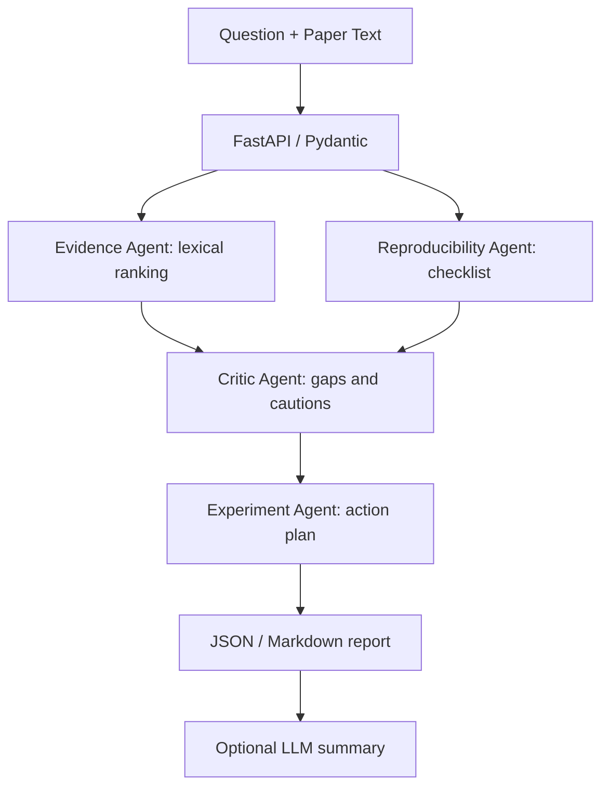

# ResearchPilot AI 🔬

**Multi-stage AI research reproducibility audit & experiment planning POC.**

> This is an original portfolio demonstration with **synthetic example papers**. It does not claim to verify scientific findings or reproduce experiments. The offline workflow is deterministic, not an LLM-powered autonomous agent system. Optional LLM summarization is available via an API key.

## Why it matters
Research teams must determine whether paper claims are sufficiently documented before spending time on reproduction. ResearchPilot AI ranks relevant text, checks reporting completeness, flags gaps, and drafts follow-up experiment plans.

## Architecture



## Features
- No API key required for deterministic offline demo
- Multi-paper comparison (up to 10 papers)
- Evidence snippets with title provenance and query-overlap scores
- Reproducibility reporting checklist with explicit missing-detail flags
- Critical findings and next-experiment plan
- Browser demo at `/`, interactive API at `/docs`, Markdown report endpoint
- Optional OpenAI-compatible summary; Docker and pytest CI

## Quick start (Windows PowerShell)

```powershell
py -3.11 -m venv .venv
.venv\Scripts\Activate.ps1
pip install -r requirements.txt
uvicorn app.main:app --reload
```

Open http://127.0.0.1:8000 and http://127.0.0.1:8000/docs.

macOS/Linux:

```bash
python3 -m venv .venv
source .venv/bin/activate
pip install -r requirements.txt
uvicorn app.main:app --reload
```

## Example request

```bash
curl -X POST http://127.0.0.1:8000/audit -H "Content-Type: application/json" --data-binary @samples/request.json
```

For a Markdown report, POST the same payload to `/audit/report`.

## Optional LLM mode

Set `OPENAI_API_KEY` and optionally `OPENAI_MODEL` / `OPENAI_CHAT_ENDPOINT` in your shell. POST to `/audit?use_llm=true`. **Never commit credentials.** If no key is set, use `/audit` without the flag. This optional step summarizes supplied heuristic findings; it does not verify the papers.

## Test

```bash
pytest -q
```

## Docker

```bash
docker build -t researchpilot-ai .
docker run --rm -p 8000:8000 researchpilot-ai
```

## Repository tree

```text
researchpilot-ai/
├── app/
│   ├── __init__.py
│   ├── engine.py          # evidence, critic, reproducibility, experiment stages
│   ├── llm.py             # optional model summarizer
│   ├── main.py            # API and browser UI
│   └── models.py          # Pydantic contracts
├── samples/request.json
├── tests/test_engine.py
├── .github/workflows/ci.yml
├── .env.example
├── .gitignore
├── Dockerfile
├── requirements.txt
└── README.md
```

## Limits and honest evaluation
- Input is pasted text or JSON, not PDF ingestion.
- Lexical matching is not semantic retrieval and cannot verify factual accuracy.
- Keyword presence measures *reporting coverage*, not actual reproducibility.
- The experiment plan is a rule-based suggestion, not a completed experiment.
- Evidence snippets may contain misleading or adversarial text; treat them as data.
- For production: add PDF parsing, hybrid retrieval, citation span offsets, controlled scientific ontologies, paper metadata, human review, model-based claim verification, auth, rate limiting, privacy controls, and benchmark evaluation.

## Future experiments
1. Benchmark lexical vs embedding-based evidence retrieval on annotated research claims.
2. Implement a LangGraph conditional reviewer with structured critique and confidence calibration.
3. Add code artifact inspection and reproducible execution in isolated containers.
4. Build a claim-to-evidence graph and contradiction review with human approval.

## Suggested demo video
Show a two-paper audit, compare checklist gaps, open the evidence snippets, download the Markdown report, then explain the limitations and next experiments.

## License
MIT (see LICENSE).
